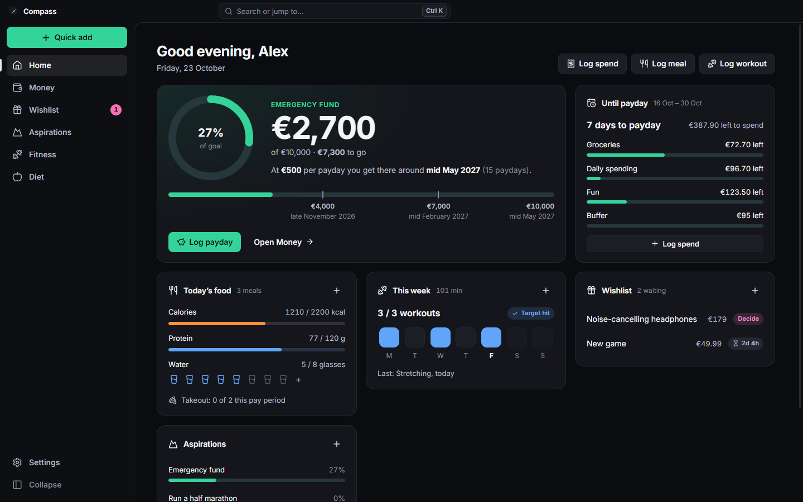
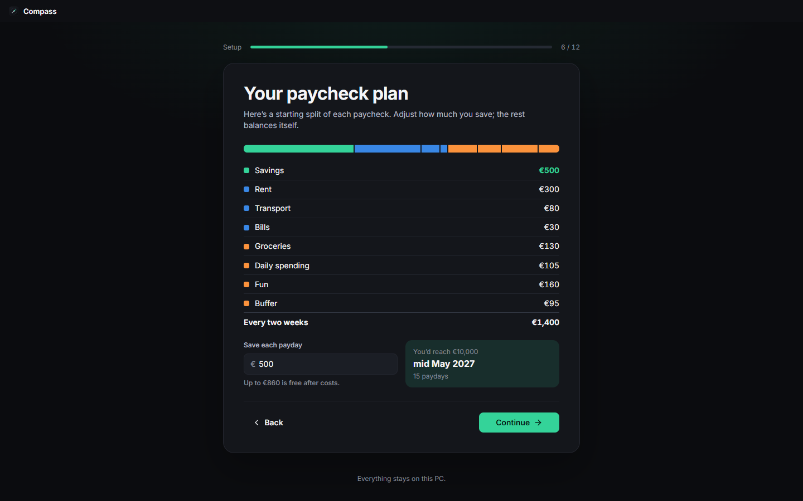
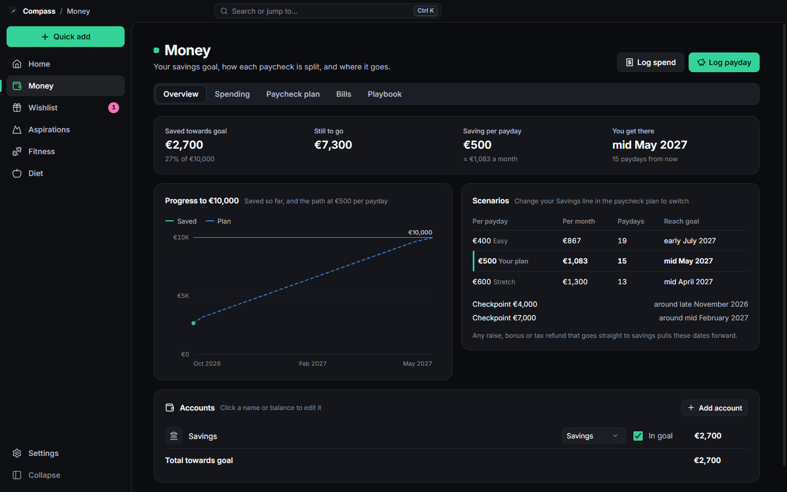

# Compass

**A fast, private, dark-mode life dashboard for Windows.** Money, wishlist, goals, fitness and food in one place. It sets itself up around you and keeps everything on your PC.

<p align="center">
  <a href="https://github.com/djdevMoo/compass/releases/latest"><b>⬇ Download the latest version</b></a>
</p>



## What it does

- **Money:** pick a savings goal and see exactly when you'll reach it. Every paycheck gets a plan (savings first, then rent, bills and spending envelopes), and you can watch what's left in each envelope until payday. It also tracks bills and subscriptions, a payday log, and a playbook of your own spending rules.
- **Wishlist:** anything you want waits a set time (72 hours by default) before you can buy it. Most impulse buys fade, and Compass counts the money you didn't spend.
- **Aspirations:** bigger goals broken into steps you can tick off.
- **Fitness:** workouts, a weekly target with streaks, and your weight trend.
- **Diet:** meals, calories, protein, water and a takeout limit.
- **Made for you:** a two-minute first-run setup asks about your pay, goal, costs and habits, then builds your plan. Switch tabs on or off, pick your currency, choose dark or light, and make it yours with any accent colour (it stays readable in both themes).
- **Fast and keyboard-friendly:** **Ctrl K** to jump anywhere, **Ctrl E** to log a spend, **Ctrl 1–6** for tabs, **Ctrl + / −** to resize everything. Undo after every change.

<p>
  
  
</p>

## Install

1. Download **`Compass-<version>-win-x64.zip`** from the [latest release](https://github.com/djdevMoo/compass/releases/latest).
2. Right-click the zip › **Extract All**. Don't run it from inside the zip.
3. Open the extracted folder and double-click **`Compass.exe`**, then click **Install**.

Compass installs just for your Windows account (no admin rights needed) and adds Start menu and Desktop shortcuts. You can then delete the downloaded folder.

- **Update:** do the same with a newer release. It offers **Update** and keeps your data.
- **Uninstall:** Settings › Apps › Installed apps › Compass › Uninstall. Your data is kept unless you tick the box.

Requires Windows 10 or 11 (64-bit).

> **Why is `Compass.exe` showing an Electron icon?** Compass runs on Electron's official, unmodified runtime, renamed. Changing the file (even its icon) would make it an unknown program that Windows Smart App Control blocks. Shortcuts, the window and the taskbar all show the Compass icon.

## Your data

Everything stays in one file on your PC (`%APPDATA%\Compass\compass.db`). Nothing is uploaded and there are no accounts or tracking. Compass backs up automatically every day (keeping the last 14), and **Settings › Your data** can export everything to a readable JSON file or import it back.

## Build from source

You need [Node.js 24](https://nodejs.org) and Windows.

```bash
npm install
```

```bash
npm run app:dev
```
Opens the app with live reload, using a separate *Compass Dev* data folder.

```bash
npm test
```

```bash
npm run check
```

```bash
npm run package
```
Builds `release/Compass-<version>-win-x64.zip`.

If Smart App Control is on, `npm install` can't unpack Electron. Run `npm run fetch-electron` afterwards: it downloads the official release, checks its SHA-256 and unpacks it with Windows' own `tar`.

**Releasing:** bump `version` in `package.json`, commit, then push a matching tag (for example `git tag v0.3.0 && git push --tags`). GitHub Actions tests, builds and publishes the release.

### How it's built

- **Electron 44** runtime, **Svelte 5** + **TypeScript** + **Vite** UI. The bundle is about 70 KB gzipped.
- **SQLite** (Node's built-in driver, WAL mode) as a small document store. Writes are batched into transactions and flushed before the window closes.
- **Locked down:** context isolation, a sandboxed renderer, no Node.js in the page, a strict Content-Security-Policy, and a tiny preload bridge as the only door to the system.
- **Scales to any screen:** sizes are in `rem`, and layouts use CSS grid and container queries, from a 480 px sliver to 4K.

```
electron/     main process, SQLite store, self-installer
src/setup/    first-run setup and the install screen
src/pages/    one file per tab
src/lib/      state, money and date maths, UI components
tests/        Vitest tests (fictional sample data)
```

## Licence

[MIT](LICENSE)
